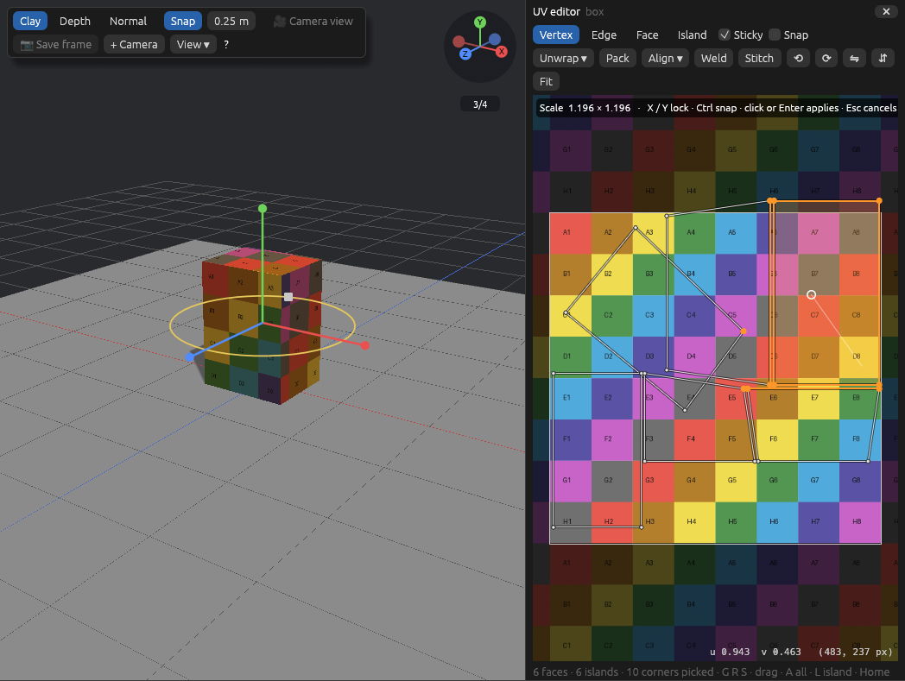

# shotstage

用 3D 白模预演镜头，给 AI 生图 / 生视频当参考。Rust + wgpu + egui，同一份代码跑在浏览器（WebAssembly）和桌面端。所有编辑操作都是命令，**网页 JS、CLI、MCP 三种入口调用的是同一张命令表**，agent 能做的和人在界面上能做的完全一样。


| 透过镜头看（干净的参考画面） | 深度 pass |
| --- | --- |
|  |  |

> 状态：M0 + 积木式搭景。场景、网格与修改器、相机、时间线关键帧、命令系统、CLI、MCP、可嵌入的网页编辑器、拖拽摆放、真实尺寸预制件（含生鲜零售、产品拍摄素材）、带骨骼可摆姿势的人物、按景别构图、截图已经可用；离屏导出（mp4 / 控制图序列）、glTF 导入在后续里程碑。

## 从模板开始

场景为空时视口中间会出现模板卡片，顶栏 **Templates** 里也能随时选：生鲜通道、产品拍摄台、白底产品图（主镜头环绕 + 细节推近）、俯拍平铺（flat lay）、双人访谈、街角、收银台、咖啡馆、空摄影棚。每个模板都包含人物、道具、灯光、相机、镜头和运镜，全部是普通的可编辑内容，选模板只算一步撤销。命令：`scene.template`、`scene.templates`。

左侧素材都有实时渲染的缩略图。相机属性里可以一键切换画幅（16:9、9:16 竖屏、1:1、4:5、4:3、2.39:1），**Roll** 做荷兰角（倾斜地平线），**Match current view** 把相机放到你当前的视角，**Safe areas** 在镜头视角里显示动作 / 字幕安全框；选中物体时会显示它的尺寸。

**对照参考图**：相机属性里 **Reference → Load picture…** 可以把一张分镜或参考照片半透明地叠在镜头画面上，用来对齐构图（命令 `camera.setReference`）。透过镜头看时，左上角会实时显示景别、角度和焦段。顶栏 **History** 列出最近的操作，点哪一步就回到它之前。

视口工具栏的 **📷 Save frame** 把当前帧透过镜头的画面存成 1920 宽的 PNG。

## 顺手的操作

- **保存 / 打开**：**Save**（Cmd/Ctrl+S）把整个场景存成 `.shotstage.json`；**Open…** 打开它（也能导入模型和图片），打开算一步，可撤销。每次改动约 2 秒后自动保存（网页存在浏览器本地，桌面版存在 `~/.shotstage/autosave.json`），下次启动会询问是否恢复上次的场景。
- **快捷操作框**：**Cmd/Ctrl+K**（或 `/`，或工具栏的 **Actions**）打开一个搜索框，能搜到所有积木、灯光预设、模板、编辑操作（保存、撤销、聚焦、复制……），以及当前选中对象能用的姿势、人物动作、物体运动或运镜。还能按名字选中物体、跳到某个镜头、透过某台相机看，以及播放 / 暂停、切换相机视角 / 故事板 / 镜头小窗、存当前帧、导出故事板。输入几个字母，↑↓ 选择，回车执行；每次都是普通的一步撤销。
- **复制 / 剪切 / 粘贴**：Cmd/Ctrl+C / X / V 通过系统剪贴板复制物体（连同子物体、动画和图片），可以贴到同一场景、另一个场景或另一个浏览器标签页；在原物体旁边粘贴会稍微错开。人物粘贴后依然可以摆姿势。命令 `entity.copy` / `entity.paste`，agent 也能用。
- **框选**：在视口空白处按住 Cmd/Ctrl 拖动，拉出选框，框住的物体（看得见、没锁定的）一起选中；Esc 取消。
- **场景列表**：每行都有显示（👁）和锁定（🔒）开关；Shift+点击 多选；双击一行，或点右侧属性顶部的名字，可以改名；右键有 聚焦 / 改名 / 复制 / 隐藏 / 锁定 / 删除；物体多时会出现按名字筛选的搜索框。
- **触控板**：Mac 触控板双指滑动 = 旋转视角（按住 Shift = 平移），双指捏合 = 缩放；鼠标滚轮仍是缩放。自动识别，也可以在视图工具栏的 **View ▾** 里固定成「Orbit」或「Zoom」。阴影、影棚光、镜头小窗、安全框的开关也都收在 **View ▾** 里。
- **从当前视角建相机**：视图工具栏的 **+ Camera**（或快捷操作框里的「New camera from this view」）在你正看着的位置放一个 16:9 相机，对准视图中心，镜头焦距自动配成和当前画面一致的取景；场景里还没有活动相机时它就成为活动相机。相机属性里的 **Match current view** 现在也是一步撤销。
- **切镜头**：时间轴的 **+ Shot** 在播放头处「切」到选中的相机（没选相机就用活动相机）：播放头落在某个镜头中间就把它一分为二，正好在镜头开头就换相机，落在空档就补到下一个镜头前。命令 `shot.cut`。
- **故事板**：时间轴上的 **Storyboard** 打开一排镜头卡片，每个镜头用它的相机在中间帧渲染一张图，标着序号、名字和时长；当前镜头高亮，点卡片就跳到那个镜头并进入相机视角，双击直接播放这个镜头，右键可以选中它的相机、跳到图上那一帧或删除镜头。改了场景后会逐张重新渲染。故事板上方的 **Export…** 把所有镜头渲染成一个独立的 HTML 页面（图片内嵌，可直接打开、打印或发给别人）。
- **镜头小窗**：在自由视角里，右下角小窗实时显示镜头相机在当前帧看到的画面，摆东西时就能同时看构图；点它进入相机视角，视图工具栏的 **Cam preview** 可以关掉。只在场景、帧或显示设置变化时才重新渲染。

## 像搭积木一样搭场景

- **从左侧素材栏拖进视口**：物体落在鼠标下的表面上，可能是地面、桌面或别的物体顶上；拖出视口松手或按 Esc 就取消。单击素材则放到画面中间。
- **真实尺寸预制件**，左侧按分组折叠，可以搜索：
  - **People**：男、女（带骨骼，见下）。
  - **Fresh retail 生鲜零售**：果蔬堆头、苹果 / 橙子 / 绿叶菜筐、西瓜箱、货架、风幕柜、卧式冰柜、熟食柜、冰鲜鱼台、面包架、收银台、购物车、购物篮、电子秤、价签牌、栈板。
  - **Product shoot 产品拍摄**：瓶、罐、易拉罐、盒、软管、立袋、咖啡杯、礼盒、按压瓶；圆台、阶梯台、方块垫高、柱台、蛋糕架、托盘、亚克力架、拱形背景板、无影墙（infinity cove）、背景纸卷、拍摄桌、柔光箱、反光板；叶枝、花、柑橘片、鹅卵石、冰块、布料、丝带、水花、装饰球。产品类可以用 `prefab.create` 的 `size: [宽, 高, 深]` 拉伸到真实产品尺寸。
  - **Furniture & set**：餐桌、椅子、沙发、床、落地灯、箱子、楼梯、墙、门洞、车、树，以及办公桌、显示器、笔记本电脑、办公椅、长椅、路灯、自行车、路锥、栅栏、盆栽。
  每个预制件都是一个组，整组一起拖动；在已选中的组里再点一次，可以选中单个部件。
- **直接拖动场景里的物体**：物体沿表面滑动，并且始终停在鼠标下面。**Shift** 竖直抬高；**Alt** 拖动时复制整组；拖动中滚动滚轮或按 **R** 旋转 15°（Shift+R 反向）；默认按 0.25 m 吸附网格，按住 **Ctrl** 可自由摆放；**Esc** 撤回这次拖动。拖动时会显示落点的投影。
- **视角**：右上角的坐标轴小部件点一下就能切到正面 / 侧面 / 俯视，**3/4** 回到默认视角；鼠标悬停时会显示物体名字。拖动空白处旋转，右键或 Shift 拖动平移，滚轮或触控板双指捏合缩放，双击物体把视角对准它。
- **专业手柄**：选中物体后出现 X/Y/Z 移动轴、水平旋转环和等比缩放方块，可以精确调整。
- **多选和编组**：Shift+点击可以多选，右侧可以编组（Ctrl+G，Ctrl+Shift+G 解组）、按 X / Y / Z 对齐（最小 / 居中 / 最大）、等距分布、一起删除。
- **锁定**：地面、背景这类物体可以勾选 Locked，在它们上面拖动会旋转视角，不会把它们拖走。
- **景别构图**：选中主体后，在右侧 "Frame it" 选角度（平视、俯、仰、鸟瞰、虫视）和方位（正面、侧面、背面等），再点 ECU / CU / MCU / MS / MFS / FS / WS / EWS，镜头就会自动就位，并切换到镜头视角。


## 给人物摆姿势

男女人物都带骨骼：16 个关节（pelvis、spine、neck、head，左右 shoulder / elbow / wrist / hip / knee / ankle），身体部件挂在关节上，转动关节就会带动整条肢体。

- 点一下人物选中整个人，右侧 **Pose** 里有站立、走、跑、坐、蹲、挥手、指向、够高处、弯腰拿取、挎篮子、推车、打电话、抱臂、展示产品等预设，**Hair** 里可以换发型（短发、长发、波波头、马尾、丸子头、光头）和发色。
- 再点身体某个部位，就会选中它的关节。直接拖动这个部位，肢体会跟着鼠标弯折（拖手会带动小臂，拖脚会带动小腿）；也可以拖关节上红 / 绿 / 蓝三个旋转环，或者在右侧用 Bend / Twist / Side 滑块微调，"Mirror" 把姿势镜像到另一侧。
- 坐、蹲这类姿势会自动降低骨盆，并让脚落回地面。
- 道具可以拿在手里：选中手机、杯子、篮子等，在 Place 里点 **Hold in hand** 选某个人的左手或右手，道具会对准手心并跟着姿势和动作一起动（命令 `entity.attach`）；**Let go** 放下。新增手机、购物袋、手提包三个手持道具。

对应的命令是 `pose.set`（预设和/或关节角度）、`pose.aim`（让某段肢体指向一个点）、`person.lookAt`（转头看向相机或某处，人物面板里有 **Look at camera**）、`pose.get`、`pose.list`、`person.setHair`。

### 真人模型

**People** 分类里有真人模型：男人、女人、男孩、女孩、老年男性、老年女性、运动员、顾客、店员（系围裙）、收银员（制服 polo 衫）、熟食柜 / 厨师（白衣白围裙）、休闲装年轻人。它们基于 MakeHuman / MPFB 的人体（CC0 素材，见 `crates/core/assets/README.md`），是连续皮肤的真实人体，带 50 多根骨骼（脊柱三节、锁骨、每根手指三节）。

- **Body**：性别、年龄、胖瘦、肌肉、身高滑块，人物原地变形，姿势保持不变。
- **Clothes**：上衣（袖长可调，0 为背心）、裤子（裤长可调，短裤到长裤）、鞋子、围裙，各自可以换颜色，也能换肤色和瞳色。衣服沿着身体裁出干净的领口、袖口和裤脚。
- **Hair**：短发、长发、波波头、马尾、丸子头、光头，长度和颜色可调。
- **Face**：18 种表情（微笑、大笑、惊讶、难过、生气、思考、说话、闭眼、眨眼……），强度可调，也可以直接设置 34 个面部动作单元。表情可以打关键帧：动画模式下（或已有表情关键帧时）点表情就会在当前帧记一帧，两帧之间脸部平滑过渡；**◆ Key** 也会带上表情。人物动作“说话”会让嘴跟着动，“挥手”会微笑，新增的“大笑”动作会笑出声的样子。命令 `person.setExpression` 加 `keyframeAt`，或 `keyframe.set` 用 `property: "expression"`。
- **Hands**：放松、张开、握拳、握持、捏取、指向、点赞、比耶、OK 等手势，可以只设左手或右手。
- 姿势库多了 23 个日常 / 零售场景的姿势：叉腰、思考、试吃、喝东西、看手机、自拍、挑选商品、看高处货架、搬箱子、拎袋子、收银、切菜、靠柜台、讲解、耸肩、鼓掌、欢呼、伸懒腰、捂脸、鞠躬、单膝跪、席地而坐、背身走开。面板上先显示常用姿势，其余在 **More poses ▾** 里。积木人偶和真人共用同一套姿势与关节名。

- 真人拿东西（**Hold in hand** / `entity.attach`）时，道具会贴在掌心，手指自动握住（小东西用捏的手势）。
- 零售互动姿势：递东西、接东西、迎客、推荐商品、扫码收银、付款、装袋、上货、端详商品、排队等候。新增 **Checkout** 模板：收银员扫码聊天，顾客用手机付款。

命令：`person.setBody`、`person.setOutfit`、`person.setExpression`、`person.expressions`、`pose.hand`、`person.get`。

每一次拖动只算一步撤销，背后调用的是 `entity.place`、`entity.moveTo`、`entity.rotate`、`prefab.create`、`camera.frame` 这些命令，agent 可以用完全相同的方式操作。

## 导入导出模型

- **导入**：点顶栏 **Import…**，或者直接把文件拖进视口。支持 glTF / GLB（层级、颜色、骨骼和蒙皮、灯光）、OBJ（附带 .mtl 时读取颜色）、STL；**FBX 和 .blend** 在桌面版和 CLI 里由本机 Blender 在后台转换（自动查找 /Applications/Blender.app，也可以用环境变量 `SHOTSTAGE_BLENDER` 指定）。
- 导入的模型是一个组，会落在鼠标所指的表面上。带骨骼的模型（例如从 Blender、Mixamo 导出的角色）可以直接摆姿势：先点模型，再点身体某处会选中最近的骨骼，拖动即可弯折，也可以拖旋转环或用滑块微调。
- OBJ / STL 没有单位：默认按尺寸猜（大于 200 按毫米，大于 20 按厘米），可以用 `unit` 指定；STL 默认 Z 轴朝上。`fitHeight` 可以把模型缩放到指定高度。
- **导出**：顶栏 **Export** 可以导出 GLB（含相机和灯光）、glTF、OBJ+MTL、STL，以及经 Blender 转换的 FBX。导出的是当前帧摆好的姿势。
- 命令：`model.import`、`model.export`；CLI：`shotstage import chair.glb -s shot.json --fit-height 0.9`、`shotstage export set.fbx -s shot.json`。

## 编辑网格（类 Blender 编辑模式）

选中一个网格（道具里的某个部件、导入的模型、基础形体都行），按 **Tab** 或在右侧点 **✏ Edit mesh** 进入编辑模式，再按 Tab 或点 **Done** 回到物体模式。视口顶部的条可以切换点 / 边 / 面和 X 光。

- **选择**：`1` / `2` / `3` 切换点、边、面；单击选中，Shift+单击加选或取消，Alt(Option)+单击选整条边环（面模式下是面环），Cmd/Ctrl+拖动框选，双击或 `L` 选鼠标下相连的整块，Ctrl+L 选和当前选择相连的部分，`A` 全选、Alt+A 全不选，Ctrl+= 扩大一圈。背面的元素默认不显示也选不到，打开 X-ray（Alt+Z）可以透视选择。
- **移动**：直接拖选中的元素就能移动；也可以拖选区中心的红绿蓝箭头沿轴移动。`G` 移动、`R` 旋转、`S` 缩放跟随鼠标，按 `X` / `Y` / `Z` 锁定轴，直接输入数字给精确值，单击或回车确认，Esc 或右键取消。打开 Snap 时按网格步长吸附（按住 Ctrl 自由移动）。
- **工具**：`E` 挤出（面沿法线，边向外），`I` 内插，Ctrl+B 倒角（滚轮加段数，变圆角），Ctrl+R 或 `C` 环切（浏览器里 Cmd+R 会刷新页面，所以 Mac 上用 Ctrl+R；鼠标悬停在边上预览，滚轮加刀数，单击切下），`F` 补面，`J` 连接两点切开面，`M` 合并顶点，`X` / Delete 删除。右侧面板里有同样的按钮，可以填精确数值，另有细分、翻转法线和 **Clean up**（合并重合顶点，修好导入时被拆开的网格）。
- **更多工具**：连按两次 `G` 边滑移（选中的边沿相邻边滑动，可输入 -1~1 的比例）；`K` 刀切（在模型表面依次单击多个点，按 Enter 或再点一次最后一个点完成；刀口贴着看得见的表面走，只切到点与点之间，点落在面内时会在那里拐弯；先选了面就只切选中的面）；`O` 开关**衰减编辑**（G / R / S 时周围的顶点按距离渐弱地跟着动，移动中滚轮调范围，面板里可选衰减曲线）；移动（G 或拖动）时按住 Cmd/Ctrl 可**吸附到顶点**；面板里的 **Spin** 把选中的边或面绕物体原点的 X/Y/Z 轴旋转挤出（360° 自动接上）；**Bridge** 桥接两个边界环（选两个面会先删掉它们再连成通道，点数不同的环用三角面连）。
- **布尔运算**：选中一个网格，在属性面板 **Boolean** 里选另一个网格和运算（差集 / 并集 / 交集），点 Apply。结果写回当前网格，另一个网格被隐藏（和 Blender 应用布尔修改器一样）。两个网格都应是封闭实体。
- 每次操作都是一步撤销。基础形体第一次被编辑时会变成可编辑网格（尺寸滑块随之消失），修改器（镜像、阵列、细分）保持在上面实时生效；带骨骼的模型不能在这里改网格。

所有工具都是普通命令，网页 JS、CLI 和 MCP 都能调用。元素用索引指定：`vertices: [3, 7]`、`edges: [[3, 7]]`、`faces: [0, 4]`，`mesh.editData` 返回顶点、面和边列表。每个工具都会返回 `selection`，也就是操作之后应该选中的元素（新索引），可以直接接着用：

```json
{"batch": [
  {"command": "mesh.extrude", "params": {"id": "box_1", "faces": [4], "distance": 0.3}},
  {"command": "mesh.inset", "params": {"id": "box_1", "faces": [4], "thickness": 0.05, "depth": -0.02}},
  {"command": "mesh.loopCut", "params": {"id": "box_1", "edge": [0, 1], "cuts": 2}}
]}
```

编辑器的编辑模式状态也开放给脚本：`editor.editMesh`（`{id, mode}` 进入，`{id: null}` 退出）、`editor.editSelect`（设置选择）、`editor.state` 会带上 `edit`。

## 贴图与 UV 编辑器

选中网格，在属性面板 **Texture** 里 **Load…** 一张图片（或复用场景里已有的图），选贴法：box / planar / cylinder / sphere 投影，或者按网格自己的 UV（uv）贴；Repeat / Offset / Turn 实时调。**Unwrap** 展开 UV：Smart（按折角切块、铺平、不重叠打包）或把 Box / Planar / Cylinder / Sphere 投影烘焙进 UV。

点 **UV editor**（Texture 面板或编辑模式面板里都有）在视口右边打开 UV 编辑器，和 Blender 的 UV 编辑器一样：



- **看**：UV 网格画在贴图上面，0–1 方框之外的部分是贴图的平铺（暗一些），底图按材质的 Repeat / Offset / Turn 放好，和模型表面上看到的完全一致；没有贴图时显示棋盘格。右下角显示鼠标处的 u / v 和像素坐标。滚轮缩放（以鼠标为中心）、触控板双指平移 / 捏合缩放、中键或右键拖动平移，**Home** 或 **Fit** 看全部，**F** 看选中部分。
- **选**：`1` / `2` / `3` / `4` 切换 UV 顶点 / 边 / 面 / 岛（展开后的一整块）；单击选中，Shift+单击加选或取消，在空白处拖动框选，双击或 `L` 选鼠标下的整块岛，Ctrl+L 选和当前选择相连的整块，`A` 全选、Alt+A 全不选。**Sticky**（默认开）：选一个 UV 顶点会连同相邻面在同一位置的角一起选，网格不会被扯开。编辑模式里在 3D 视图选了面时，UV 编辑器只显示这些面（**Only picked** 可关）。
- **改**：直接拖动选中的部分；或 `G` 移动、`R` 旋转、`S` 缩放跟随鼠标，`X` / `Y` 锁定 u / v 方向，按住 Ctrl（或打开 **Snap**）吸附到贴图像素（旋转按 15°、缩放按 0.1），单击或回车确认，Esc 或右键取消。工具条上有 **Align**（左 / 中 / 右 / 上 / 中 / 下对齐成一列或一行）、**Weld**（合到一点）、**Stitch**（把沿接缝切开的两块缝回去）、旋转 90°、左右 / 上下镜像、**Pack**（所有岛或选中的岛重新不重叠地排进方框，保持相对大小，竖长的会转平）、**Unwrap**（只展开选中的面）。
- 每次拖动或操作都是一步撤销，都是普通命令：拖动发的是 `mesh.uvSet`。

UV 编辑的命令都以「面角」`[面, 面内序号]` 指定点，也可以给 `faces`，加 `sticky: true` 连带同位置的角，加 `islands: true` 扩到整块岛：

```json
{"batch": [
  {"command": "mesh.unwrap", "params": {"id": "box_1", "method": "smart"}},
  {"command": "mesh.uvIslands", "params": {"id": "box_1"}},
  {"command": "mesh.uvTransform", "params": {"id": "box_1", "faces": [2], "islands": true, "rotate": 90, "scale": [1.5, 1.5]}},
  {"command": "mesh.uvAlign", "params": {"id": "box_1", "corners": [[2, 0], [2, 3]], "axis": "u", "to": "min"}},
  {"command": "mesh.uvWeld", "params": {"id": "box_1", "faces": [0, 1], "mode": "stitch"}},
  {"command": "mesh.uvPack", "params": {"id": "box_1", "margin": 0.02}}
]}
```

`mesh.uvSelect` 把面 / 角 / UV 空间里的框解析成角列表（不改任何东西），`mesh.uvData` 返回 UV 坐标和最终贴图坐标。编辑器里的 UV 编辑器状态也开放：`editor.uvEditor`（`{id, mode, sticky}` 打开，`{id: null}` 关闭）、`editor.uvSelect`（设置选择），`editor.state` 会带上 `uv`。

## 图片

把 PNG / JPEG / WebP 拖进视口，或者在左侧 **Images** 里选一种用法，图片会按原比例变成场景里的一张卡片：

- **Card**：立着的图片（参考照片、海报、指示牌），落在下方的表面上；
- **Cut-out**：始终转向镜头的公告板，适合抠好图的人物、树木（带透明背景的 PNG 默认就是这种，透明部分是镂空的）；
- **Backdrop**：放在整个场景后面、正对当前镜头并铺满画面的背景图；
- **Floor**：平铺在地面上（地毯、平面图、地贴）。

右侧可以切换"始终朝向镜头"和调高度（宽度按比例变化）。图片原样显示、不受灯光影响，深度和法线 pass 里也会正确出现。命令：`image.import`、`image.set`、`image.get`；超过 2048 像素的图会自动缩小。

## 灯光

灯光是可选的：场景里没有灯也没有天空时，用的是均匀的白模光；一旦放了灯或选了天空，Clay 画面和截图就由它们照亮。视口工具栏的 **Studio light** 可以随时切回白模光对比。

- 左侧 **Lights** 分组：太阳光、点光、聚光、面光（柔光箱 / 窗户）可以拖进场景，会悬在落点上方并对准它；右侧可以调颜色或色温（2700K 暖光 … 7500K 阴天）、强度、聚光角度、柔和度、面光尺寸，以及这盏灯是否投影。
- **阴影**：最亮的四盏投影灯同时投下阴影（太阳光、聚光、面光、点光都行；面光的影子更软）。**Sky ▾** 里可以整体开关阴影、调深浅和柔和度；视口 **View ▾ › Shadows** 只影响视口显示。没有灯时由白模主光或天空里的太阳投下柔和的影子。
- **天空 / 环境光（Sky ▾）**：内置 Day（晴天）、Sunset（日落）、Overcast（阴天）、Night（夜晚）、Softbox（影棚柔光箱）和 Color（单色无缝背景纸，比如白底、黑底、绿幕）；也可以 **Import HDRI…** 导入 `.hdr` 文件或 2:1 全景图（直接把 `.hdr` 拖进视口也行）。天空会从四面八方柔和地照亮场景，可以显示在背景里，可调染色、亮度和旋转（旋转会带着天空里的太阳一起转）。**Add matching sun** 会在天空最亮的地方加一盏同色太阳光，让影子和天空对得上。
- **一键布光（18 种）**：人像有三点布光、Loop、伦勃朗、蝴蝶光、Clamshell 美妆光、侧光（Split）；产品和门店有产品柔光、高调白底（High key）、生鲜柜台（Counter）；氛围有低调（Low key）、逆光、窗光、霓虹、舞台追光；户外有黄金时刻、日光、阴天、夜晚；以及 "No lights"（清除所有灯和天空）。会围绕当前选中的物体、按当前镜头的方向布置；户外和背景类预设会顺带设好对应的天空，并把天空里的太阳转到和太阳光同一个方向。
- 产品拍摄里的 **Softbox** 预制件本身就是一盏面光。
- 选中太阳光 / 聚光 / 面光时，视口里会显示它照向的那个点，直接拖动就能改变照射方向。
- 命令：`entity.create`（`type: "light"`）、`light.set`、`light.preset`、`light.list`、`light.shadows`、`light.fromEnvironment`、`environment.set`、`environment.import`、`environment.list`；灯沿自身 -Z 方向照射，可以用 `camera.lookAt` 对准目标。

## 动画与运镜

- **时间轴**（底部）：刻度尺可以直接拖动预览；每个有动画的物体一行，菱形是关键帧——拖动菱形改时间，右键选缓动（平滑、缓入、缓出、线性、回弹、定格）或删除，双击行在当前帧打关键帧。**◆ Key**（快捷键 K）给选中的物体打帧（人物会一次打全身关节），**Auto-key** 打开后所有移动、旋转、摆姿势都自动在当前帧记帧。**🎥 Preview shot** 从头透过镜头播放。←/→ 逐帧（Shift 十帧），Home/End 跳到首尾。
- **镜头条**：时间轴上 Shots 一行显示每个镜头（名字和相机）。拖动镜头条整体平移，拖两端改起止帧，双击透过它的相机看，右键可以换相机、在播放头处一分为二、删除，空白处右键可以新建镜头（命令 `shot.set`）。
- **运动路径**：选中有动画的物体或相机，视口里会画出它的运动轨迹，每个关键帧是一个点，可以直接拖动改位置（Shift 上下）。
- **一键动画（右侧 Animate）**，都从当前帧开始，生成普通的可编辑关键帧，一步撤销：
  - 运镜（选中相机，围绕最近选过的物体）：推 / 拉、推近、拉远揭示、横移、升降、摇、俯仰、左右环绕、摇臂升降、希区柯克变焦、变焦、甩镜、跟拍、手持晃动、无人机飞越、360° 环绕。
  - 物体：转台旋转、弹跳、悬浮、落入、滑入、弹出、摇摆、英雄登场，以及沿路径移动（`points`）。
  - 人物：走路、挥手、捡东西、左右张望、点头、大笑、坐下、站起。
  - 可以调时长和强度，也可以搜索。命令：`motion.apply`、`motion.list`，以及 `keyframe.move`、`keyframe.setInterp`。
- **时间轴缩放**：在时间轴上双指捏合或 Cmd/Ctrl+滚轮放大（以指针处为中心），左右滑动平移；播放时会跟着播放头翻页；**Fit**（或双击时间尺）回到整条时间轴。
- **整段调时间**：在时间轴上拖动一行关键帧之间的横条，整段动画一起平移；右键这一行可以 从播放头开始 / 变快 / 变慢。都是一步撤销。命令 `keyframe.retime`（`offset` 平移、`scale` 变速、`from`/`to` 限定范围）。

## 导出动画和分镜

- **带动画的导出**：场景里有关键帧时，GLB / glTF / FBX 导出会带上整段时间轴的动画（运镜、物体运动、人物动作，逐帧采样），在 Blender、Unreal 等软件里直接能播放；`animation: false` 只导出当前帧。
- **逐帧序列**：`shotstage render -s shot.json -o frames/ --pass clay,depth,normal --video` 按镜头切换逐帧渲染（深度图整段用同一个深度范围，不会闪），同时输出每帧相机参数 `camera.json`；装了 ffmpeg 时 `--video` 直接合成 MP4，可以作为视频模型的深度 / 法线控制序列。
- **分镜**：`shotstage storyboard -s shot.json -o board/` 给每个镜头渲染首帧、中间帧、尾帧（加 `--depth` 同时出深度图），并生成 `storyboard.json`（镜头描述、逐帧相机内外参）和可直接打开的 `index.html`。首尾帧正好可以作为图生视频模型的首帧 / 尾帧条件。

## 结构

| crate | 作用 | 依赖 GPU / 浏览器 |
| --- | --- | --- |
| `crates/core` | 场景文档、可编辑网格（n-gon）、参数化几何体、修改器栈、相机模型、时间线求值、镜头描述 | 否 |
| `crates/commands` | 命令注册表、JSON Schema、撤销/重做、原子批量、拖拽合并撤销 | 否 |
| `crates/render` | wgpu 渲染器：粘土 / 深度 / 法线 pass，网格、相机视锥、拾取 | GPU |
| `crates/app` | egui 编辑器；wasm 导出 `mount(container, options)` | GPU / 浏览器 |
| `crates/cli` | `shotstage` 命令行：`run` / `batch` / `serve` / `mcp`，实时桥（`--live`） | 否（渲染时用 GPU） |

## 在网页里嵌入

```sh
rustup target add wasm32-unknown-unknown
cargo install wasm-bindgen-cli --version 0.2.130   # 与 Cargo.lock 中的 wasm-bindgen 版本一致
./scripts/build-web.sh                             # 产出 dist/pkg/shotstage_app.js + _bg.wasm
python3 -m http.server -d dist 8080                # 打开 http://localhost:8080
```

编辑器挂到任意 DOM 容器里，并填满这个容器，跟随它的尺寸变化。同一页面可以挂多个实例，每个实例的场景和历史互相独立：

```js
import init, { mount } from "./pkg/shotstage_app.js";
await init();

const editor = await mount("#stage", { scene: savedSceneJson }); // 元素或 CSS 选择器；scene 可选
window.shotstage = editor;                                        // 可选：挂到全局给 agent / 控制台用

editor.dispatch("entity.create", { type: "mesh", primitive: { shape: "cube", size: [1, 1, 1] } });
editor.batch([                                                    // 一个事务：全部成功或全部回滚，一步撤销
  { command: "entity.create", params: { type: "camera", id: "cam", position: [0, 1.6, 5] } },
  { command: "camera.lookAt", params: { id: "cam", target: [0, 1, 0] } },
  { command: "camera.dollyMove", params: { id: "cam", distance: 2, start: 0, end: 48 } },
]);
editor.request({ command: "entity.translate", params: { id: "cube_1", delta: [0.1, 0, 0] }, merge: "drag-7" }); // 同一 merge key 合并成一步撤销
editor.commands();                 // 全部命令 + 参数 JSON Schema
editor.scene();                    // 场景文档（保存它，下次 mount 时传回）
const sub = editor.on(ev => {});   // { type: "change" | "command", revision, request }
editor.off(sub);
const shot = await editor.snapshot({ pass: "depth", width: 1024 }); // 透过镜头截图：{ dataUrl, data(base64), width, height, ... }
const board = await editor.call("render.storyboard", { passes: ["clay", "depth"] }); // 分镜：每个镜头首/中/尾帧 + 镜头描述 + 相机数据，图片是 data URL，board.html 是独立网页
const seq = await editor.call("render.sequence", { start: 0, end: 47, passes: ["depth"] }); // 逐帧控制序列（统一深度范围）+ 每帧相机参数
editor.destroy();                  // 停止渲染并移除 canvas
```

`editor.call(command, params)` 能调用命令目录里的**任何**命令（包括要渲染的那几个），返回 Promise；`dispatch` 是它的同步版本，适合文档命令。失败时抛出 `Error`，`error.code` 取值为 `invalid_params`、`unknown_command`、`failed`、`unsupported`、`nothing_to_undo` 等。编辑器视图命令 `editor.select`、`editor.setFrame`、`editor.setView`、`editor.state` 也在同一张命令表里，CLI 和 MCP 也能用。

浏览器有 WebGPU 时用 WebGPU，没有时自动回退到 WebGL2（已在 SwiftShader WebGL2 下验证）。

## 命令行与 MCP

**一张命令表，三个入口**：网页 JS、CLI、MCP 调用的是同一张命令表，参数（JSON Schema）和返回值完全一样。完整参考见 [docs/api.md](docs/api.md)（由 `shotstage commands --markdown` 从命令表生成）。需要场景以外资源的「宿主命令」也在表里，并标明需要什么：`gpu`（渲染）、`files`（读写文件）、`view`（编辑器的选中和播放头）；每个入口都实现了全部宿主命令，测试会检查没有遗漏。

```sh
cargo build --release -p shotstage-cli
shotstage commands --brief                       # 命令目录
shotstage commands                               # 带 JSON Schema 的完整目录
shotstage run entity.create '{"type":"mesh","primitive":{"shape":"sphere","radius":0.5,"segments":24,"rings":12}}' -s shot.json
shotstage run model.import '{"path":"chair.glb","fitHeight":0.9}' -s shot.json   # 有文件系统的入口可以直接给路径
shotstage run render.storyboard '{"out":"board","passes":["clay","depth"]}' -s shot.json
shotstage batch steps.json -s shot.json          # [{"command": ..., "params": ...}, ...]
shotstage serve -s shot.json                     # 常驻会话：stdin/stdout 每行一个 JSON 请求
shotstage mcp -s shot.json                       # MCP（stdio），改动自动写回 shot.json
shotstage snapshot -s shot.json -o frame.png --pass depth   # 透过镜头渲染 PNG（需要 GPU 或软件 Vulkan，如 lavapipe）
```

`snapshot`、`storyboard`、`render`、`import`、`export` 这些子命令只是 `render.snapshot`、`render.storyboard`、`render.sequence`、`model.import`、`model.export` 的快捷写法。`serve` 的每行请求格式为 `{"id": 1, "command": "...", "params": {...}}` 或 `{"id": 2, "batch": [...]}`，回复会带回同一个 `id`；`serve` 和 `mcp` 里的 `editor.select` / `editor.setFrame` 作用于会话自己的视图，比如设了播放头之后 `render.snapshot` 默认渲染那一帧。

接到 Claude Code：

```sh
claude mcp add shotstage -- /path/to/shotstage mcp --scene /abs/path/shot.json
```

MCP 服务把每条命令都发布成一个工具（`entity.create` 对应 `entity_create`，入参就是该命令的 JSON Schema），另外提供 `command_list`、`command_run`、`command_batch` 三个通用工具；工具预算紧的客户端可以加 `--compact`，只发布通用工具和几个常用工具，其余照样能用 `command_run` 调。`render_snapshot` 以 MCP 图片内容返回，模型可以直接看到画面，再根据画面修正构图；`render_storyboard` 把分镜写到场景文件旁边的 `<场景>.storyboard/` 文件夹，同时把各镜头的画面作为图片返回。

### 端到端示例

[examples/fresh-produce-ad.json](examples/fresh-produce-ad.json) 是一串 MCP 工具调用，和 Claude 实际会做的一样：从空场景搭一个生鲜货架、放一位挑水果的顾客（手里挎着篮子）、布光、用景别给两台相机构图、加推镜、切两个镜头，再截图检查、出分镜。用 [examples/run-mcp-example.py](examples/run-mcp-example.py) 回放（只用 Python 标准库）：

```sh
cargo build -p shotstage-cli
python3 examples/run-mcp-example.py examples/fresh-produce-ad.json --scene /tmp/ad.shotstage.json
python3 examples/run-mcp-example.py examples/fresh-produce-ad.json --live    # 在浏览器里看着它搭
```

### 实时桥：让 Claude 直接操作你打开的编辑器

```sh
./scripts/build-web.sh
claude mcp add shotstage -- /path/to/shotstage mcp --scene /abs/path/shot.json --live --web /path/to/shotstage/dist
```

`--live` 让 MCP 服务在 `127.0.0.1:7777`（`--port` 可改）开一个桥，并用 `--web` 指定的网页包提供编辑器。在浏览器里打开 http://127.0.0.1:7777/ ，页面会自己连上（右上角显示「agent connected」）。之后 Claude 的每个操作都在这个页面里执行：你能看着场景一步步搭起来，改动进同一个撤销历史，截图和分镜也由浏览器渲染（服务器不需要 GPU）。工具 `bridge_status` 告诉 Claude 有没有连上、该打开哪个地址。

- 页面里本来有场景时，以页面为准；页面是空的，就把 Claude 手上的场景带过去。
- 浏览器关掉或断开后，命令自动回到本地副本继续执行（每次改动后都同步过），场景仍会写回 `--scene` 文件；再打开页面会重新连上。
- 自己的页面也能接：`import { connectBridge } from "./bridge.js"; connectBridge(editor, "ws://127.0.0.1:7777/bridge")`，或者在地址后加 `?bridge=ws://127.0.0.1:7777/bridge`。只接受 localhost 页面连接，其他来源用 `--allow-origin https://你的域名` 放行。
- `shotstage serve --live` 同样可用，适合用脚本驱动浏览器里的编辑器。

## 命令目录

完整的参数说明见 [docs/api.md](docs/api.md)。

| 分组 | 命令 |
| --- | --- |
| 会话 | `command.list` `history.undo` `history.redo` `history.info` |
| 模板 | `scene.template` `scene.templates` |
| 场景 | `scene.inspect` `scene.summary` `scene.new` `scene.load` `scene.evaluate` `scene.raycast` `scene.save` `scene.open` |
| 编组排列 | `entity.group` `entity.ungroup` `entity.align` `entity.distribute` |
| 积木摆放 | `prefab.create`（`size` 拉伸到指定尺寸） `prefab.list` `entity.place`（`ray` 落到射线击中处 / `on` 放到某物顶上 / `nextTo`+`side`(+`view` 按镜头左右) 并排 / 不带参数时落到正下方）`entity.moveTo` `entity.rotate` `entity.face` `entity.bounds` `entity.attach` |
| 实体 | `entity.create` `entity.delete` `entity.duplicate`（连同子物体） `entity.rename` `entity.get` `entity.setTransform` `entity.translate` `entity.setParent` `entity.setVisible` `entity.setLocked` |
| 网格 | `mesh.setPrimitive` `mesh.setData` `mesh.setColor` `mesh.addModifier` `mesh.removeModifier` `mesh.applyModifiers` `mesh.join` `mesh.setOriginToCenter` `mesh.stats` `mesh.exportObj` |
| 网格编辑 | `mesh.editData` `mesh.makeEditable` `mesh.select`（loop / ring / faceLoop / linked / more / all） `mesh.transformElements` `mesh.extrude` `mesh.inset` `mesh.bevel` `mesh.loopCut` `mesh.subdivideFaces` `mesh.connect` `mesh.merge` `mesh.mergeByDistance` `mesh.fill` `mesh.flipNormals` `mesh.deleteElements` `mesh.bridge` `mesh.edgeSlide` `mesh.bisect`（平面切割，可删除一侧） `mesh.knife`（沿表面点路径切） `mesh.spin`（旋转挤出） `mesh.transformElements` 的 `proportional` 参数（衰减编辑） `mesh.boolean`（union / difference / intersect） |
| 相机 | `camera.frame`（景别 + 角度 + 方位自动构图） `camera.setLens` `camera.lookAt` `camera.setActive` `camera.describe` `camera.trajectory` `camera.orbitMove` `camera.dollyMove` |
| 人物 | `pose.set` `pose.aim` `pose.get` `pose.list` `pose.hand` `person.setHair` `person.setBody` `person.setOutfit` `person.setExpression` `person.expressions` `person.get` |
| 贴图与 UV | `mesh.setMaterial` `mesh.unwrap` `mesh.uvData` `mesh.uvTransform` `mesh.uvSet` `mesh.uvAlign` `mesh.uvWeld`（center / stitch） `mesh.uvPack` `mesh.uvSelect` `mesh.uvIslands` |
| 模型 | `model.import` `model.export`（都可以用 `path`） |
| 图片 | `image.import` `image.set` `image.get` `camera.setReference` |
| 灯光 | `light.set` `light.preset` `light.list` `light.shadows` `light.fromEnvironment`（创建用 `entity.create` 的 `type: "light"`） |
| 天空 / 环境光 | `environment.set` `environment.import`（HDRI）`environment.list` |
| 渲染 | `render.snapshot`（clay / depth / normal，返回 PNG） `render.storyboard`（分镜） `render.sequence`（逐帧序列 + 相机数据，可出 MP4） |
| 动画 | `motion.apply` `motion.list` `keyframe.move` `keyframe.retime` `keyframe.setInterp` |
| 时间线 | `timeline.set` `keyframe.set` `keyframe.delete` `keyframe.list` `shot.create` `shot.cut` `shot.set` `shot.delete` |
| 复制粘贴 | `entity.copy` `entity.paste` |
| 编辑器视图 | `editor.select` `editor.setFrame` `editor.setView` `editor.state` `editor.editMesh` `editor.editSelect` `editor.uvEditor` `editor.uvSelect` |

约定：长度单位是米，角度单位是度，时间单位是帧；+Y 朝上，地面是 y = 0，物体正面朝 +Z，相机朝 -Z 看。`camera.frame` 生成的镜头再用 `camera.describe` 描述时，得到的是同一个景别。`camera.trajectory` 输出的是 OpenCV 坐标轴下的逐帧内参和 3×4 世界到相机矩阵（RealEstate10K 风格），可以直接喂给相机控制类视频模型。`camera.describe` 用影视术语描述镜头，例如 `medium shot, low angle, 35mm normal lens`。

参数一律当作不可信输入处理：缺字段、类型错误、越界或未知字段都会返回错误，场景保持不变。

**新增命令时**：在 `crates/commands` 里注册，三个入口自动就有；然后运行 `cargo run -p shotstage-cli -- commands --markdown > docs/api.md` 更新参考文档。

## 开发

```sh
cargo test --workspace
cargo clippy --workspace --all-targets
cargo clippy -p shotstage-app --target wasm32-unknown-unknown
cargo run -p shotstage-app [scene.json]          # 原生编辑器
```

## 路线图

- **M1 场景编辑**：glTF/GLB 导入（可以把 Blender 里做的模型带进来）、按名字引用物体、防穿插、IK 摆姿势、更多网格命令
- **M2 镜头与时间线**：时间线 UI（关键帧拖拽、曲线）、相机支架（轨道 / 摇臂）、更多命名运镜
- **M3 导出**：离屏逐帧渲染，导出首尾帧、mp4、深度 / 法线 / OpenPose / ID 序列，以及导出包
- **M4 Agent**：~~`render_snapshot` 返回图片~~、~~MCP 实时桥（agent 驱动用户打开的网页编辑器）~~（已完成）；权限分级
- **二期网格编辑**：点 / 边 / 面编辑模式，挤出、倒角、循环切割、布尔运算、减面

## License

MIT OR Apache-2.0
