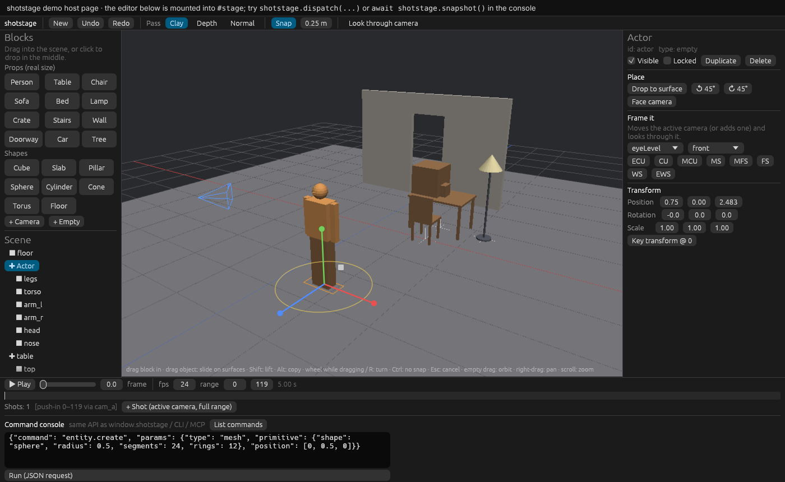
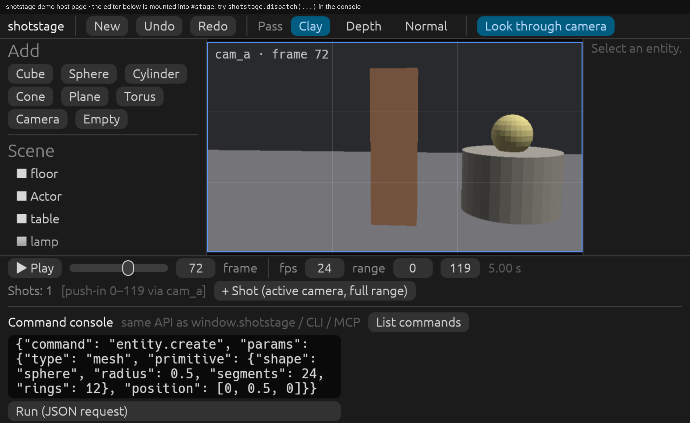
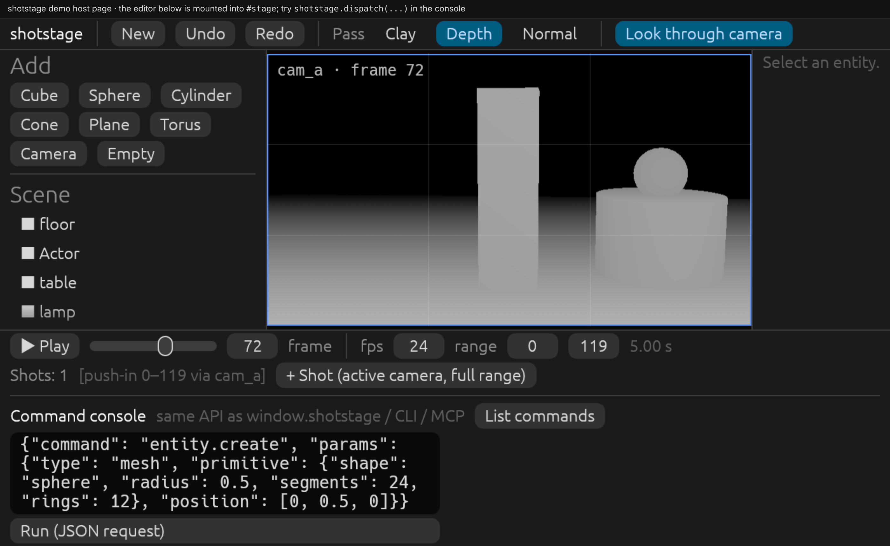
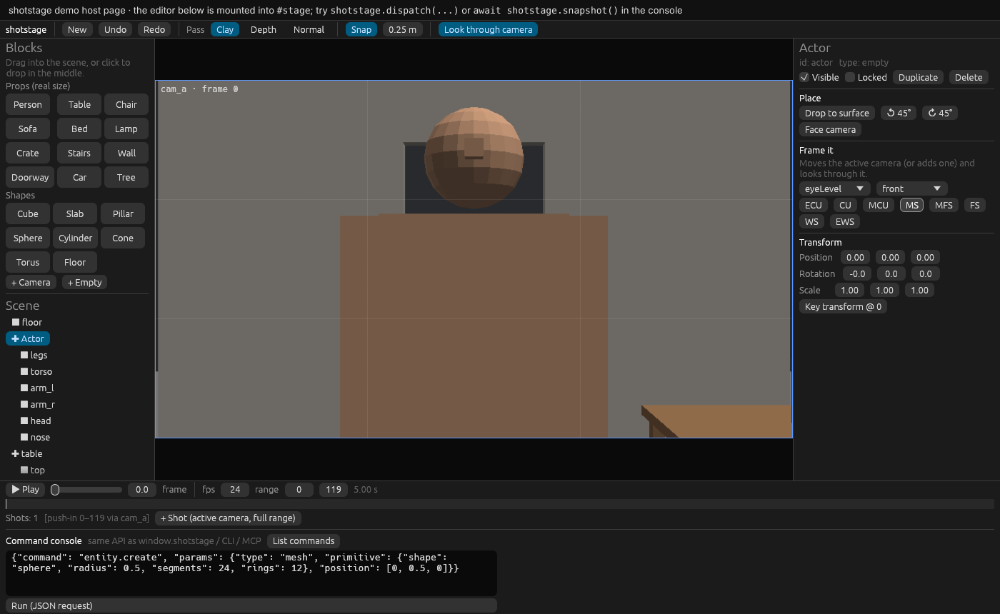

# shotstage

用 3D 白模预演镜头，给 AI 生图 / 生视频当参考。Rust + wgpu + egui，同一份代码跑在浏览器（WebAssembly）和桌面端。所有编辑操作都是命令，**网页 JS、CLI、MCP 三种入口调用的是同一张命令表**，agent 能做的和人在界面上能做的完全一样。



| 透过镜头看（干净的参考画面） | 深度 pass |
| --- | --- |
|  |  |

> 状态：M0 + 积木式搭景。场景、网格与修改器、相机、时间线关键帧、命令系统、CLI、MCP、可嵌入的网页编辑器、拖拽摆放、真实尺寸预制件（含生鲜零售、产品拍摄素材）、带骨骼可摆姿势的人物、按景别构图、截图已经可用；离屏导出（mp4 / 控制图序列）、glTF 导入在后续里程碑。

## 从模板开始

场景为空时视口中间会出现模板卡片，顶栏 **Templates** 里也能随时选：生鲜通道、产品拍摄台、双人访谈、街角、咖啡馆、空摄影棚。每个模板都包含人物、道具、灯光、相机、镜头和运镜，全部是普通的可编辑内容，选模板只算一步撤销。命令：`scene.template`、`scene.templates`。

左侧素材都有实时渲染的缩略图。相机属性里可以一键切换画幅（16:9、9:16 竖屏、1:1、4:5、4:3、2.39:1），**Roll** 做荷兰角（倾斜地平线），**Match current view** 把相机放到你当前的视角，**Safe areas** 在镜头视角里显示动作 / 字幕安全框；选中物体时会显示它的尺寸。

**对照参考图**：相机属性里 **Reference → Load picture…** 可以把一张分镜或参考照片半透明地叠在镜头画面上，用来对齐构图（命令 `camera.setReference`）。透过镜头看时，左上角会实时显示景别、角度和焦段。顶栏 **History** 列出最近的操作，点哪一步就回到它之前。

视口工具栏的 **📷 Save frame** 把当前帧透过镜头的画面存成 1920 宽的 PNG。

## 顺手的操作

- **保存 / 打开**：**Save**（Cmd/Ctrl+S）把整个场景存成 `.shotstage.json`；**Open…** 打开它（也能导入模型和图片），打开算一步，可撤销。每次改动约 2 秒后自动保存（网页存在浏览器本地，桌面版存在 `~/.shotstage/autosave.json`），下次启动会询问是否恢复上次的场景。
- **快捷操作框**：**Cmd/Ctrl+K**（或 `/`，或工具栏的 **Actions**）打开一个搜索框，能搜到所有积木、灯光预设、模板、编辑操作（保存、撤销、聚焦、复制……），以及当前选中对象能用的姿势、人物动作、物体运动或运镜。输入几个字母，↑↓ 选择，回车执行；每次都是普通的一步撤销。
- **复制 / 剪切 / 粘贴**：Cmd/Ctrl+C / X / V 通过系统剪贴板复制物体（连同子物体、动画和图片），可以贴到同一场景、另一个场景或另一个浏览器标签页；在原物体旁边粘贴会稍微错开。人物粘贴后依然可以摆姿势。命令 `entity.copy` / `entity.paste`，agent 也能用。
- **场景列表**：每行都有显示（👁）和锁定（🔒）开关；Shift+点击 多选；双击一行，或点右侧属性顶部的名字，可以改名；右键有 聚焦 / 改名 / 复制 / 隐藏 / 锁定 / 删除；物体多时会出现按名字筛选的搜索框。
- **触控板**：Mac 触控板双指滑动 = 旋转视角（按住 Shift = 平移），双指捏合 = 缩放；鼠标滚轮仍是缩放。自动识别，也可以在视图工具栏的 **View ▾** 里固定成「Orbit」或「Zoom」。阴影、影棚光、镜头小窗的开关也都收在 **View ▾** 里。
- **从当前视角建相机**：视图工具栏的 **+ Camera**（或快捷操作框里的「New camera from this view」）在你正看着的位置放一个 16:9 相机，对准视图中心，镜头焦距自动配成和当前画面一致的取景；场景里还没有活动相机时它就成为活动相机。相机属性里的 **Match current view** 现在也是一步撤销。
- **故事板**：时间轴上的 **Storyboard** 打开一排镜头卡片，每个镜头用它的相机在中间帧渲染一张图，标着序号、名字和时长；当前镜头高亮，点卡片就跳到那个镜头并进入相机视角。改了场景后会逐张重新渲染。
- **镜头小窗**：在自由视角里，右下角小窗实时显示镜头相机在当前帧看到的画面，摆东西时就能同时看构图；点它进入相机视角，视图工具栏的 **Cam preview** 可以关掉。只在场景、帧或显示设置变化时才重新渲染。

## 像搭积木一样搭场景

- **从左侧素材栏拖进视口**：物体落在鼠标下的表面上，可能是地面、桌面或别的物体顶上；拖出视口松手或按 Esc 就取消。单击素材则放到画面中间。
- **真实尺寸预制件**，左侧按分组折叠，可以搜索：
  - **People**：男、女（带骨骼，见下）。
  - **Fresh retail 生鲜零售**：果蔬堆头、苹果 / 橙子 / 绿叶菜筐、西瓜箱、货架、风幕柜、卧式冰柜、熟食柜、冰鲜鱼台、面包架、收银台、购物车、购物篮、电子秤、价签牌、栈板。
  - **Product shoot 产品拍摄**：瓶、罐、易拉罐、盒、软管、立袋、咖啡杯、礼盒、按压瓶；圆台、阶梯台、方块垫高、柱台、蛋糕架、托盘、亚克力架、拱形背景板、无影墙（infinity cove）、背景纸卷、拍摄桌、柔光箱、反光板；叶枝、花、柑橘片、鹅卵石、冰块、布料、丝带、水花、装饰球。产品类可以用 `prefab.create` 的 `size: [宽, 高, 深]` 拉伸到真实产品尺寸。
  - **Furniture & set**：餐桌、椅子、沙发、床、落地灯、箱子、楼梯、墙、门洞、车、树，以及办公桌、显示器、笔记本电脑、办公椅、长椅、路灯、自行车、路锥、栅栏、盆栽。
  每个预制件都是一个组，整组一起拖动；在已选中的组里再点一次，可以选中单个部件。
- **直接拖动场景里的物体**：物体沿表面滑动，并且始终停在鼠标下面。**Shift** 竖直抬高；**Alt** 拖动时复制整组；拖动中滚动滚轮或按 **R** 旋转 15°（Shift+R 反向）；默认按 0.25 m 吸附网格，按住 **Ctrl** 可自由摆放；**Esc** 撤回这次拖动。拖动时会显示落点的投影。
- **视角**：右上角的坐标轴小部件点一下就能切到正面 / 侧面 / 俯视，**3/4** 回到默认视角；鼠标悬停时会显示物体名字。拖动空白处旋转，右键或 Shift 拖动平移，滚轮或触控板双指捏合缩放，双击物体把视角对准它。
- **专业手柄**：选中物体后出现 X/Y/Z 移动轴、水平旋转环和等比缩放方块，可以精确调整。
- **多选和编组**：Shift+点击可以多选，右侧可以编组（Ctrl+G，Ctrl+Shift+G 解组）、按 X / Y / Z 对齐（最小 / 居中 / 最大）、等距分布、一起删除。
- **锁定**：地面、背景这类物体可以勾选 Locked，在它们上面拖动会旋转视角，不会把它们拖走。
- **景别构图**：选中主体后，在右侧 "Frame it" 选角度（平视、俯、仰、鸟瞰、虫视）和方位（正面、侧面、背面等），再点 ECU / CU / MCU / MS / MFS / FS / WS / EWS，镜头就会自动就位，并切换到镜头视角。



## 给人物摆姿势

男女人物都带骨骼：16 个关节（pelvis、spine、neck、head，左右 shoulder / elbow / wrist / hip / knee / ankle），身体部件挂在关节上，转动关节就会带动整条肢体。

- 点一下人物选中整个人，右侧 **Pose** 里有站立、走、跑、坐、蹲、挥手、指向、够高处、弯腰拿取、挎篮子、推车、打电话、抱臂、展示产品等预设，**Hair** 里可以换发型（短发、长发、波波头、马尾、丸子头、光头）和发色。
- 再点身体某个部位，就会选中它的关节。直接拖动这个部位，肢体会跟着鼠标弯折（拖手会带动小臂，拖脚会带动小腿）；也可以拖关节上红 / 绿 / 蓝三个旋转环，或者在右侧用 Bend / Twist / Side 滑块微调，"Mirror" 把姿势镜像到另一侧。
- 坐、蹲这类姿势会自动降低骨盆，并让脚落回地面。
- 道具可以拿在手里：选中手机、杯子、篮子等，在 Place 里点 **Hold in hand** 选某个人的左手或右手，道具会对准手心并跟着姿势和动作一起动（命令 `entity.attach`）；**Let go** 放下。新增手机、购物袋、手提包三个手持道具。

对应的命令是 `pose.set`（预设和/或关节角度）、`pose.aim`（让某段肢体指向一个点）、`person.lookAt`（转头看向相机或某处，人物面板里有 **Look at camera**）、`pose.get`、`pose.list`、`person.setHair`。

每一次拖动只算一步撤销，背后调用的是 `entity.place`、`entity.moveTo`、`entity.rotate`、`prefab.create`、`camera.frame` 这些命令，agent 可以用完全相同的方式操作。

## 导入导出模型

- **导入**：点顶栏 **Import…**，或者直接把文件拖进视口。支持 glTF / GLB（层级、颜色、骨骼和蒙皮、灯光）、OBJ（附带 .mtl 时读取颜色）、STL；**FBX 和 .blend** 在桌面版和 CLI 里由本机 Blender 在后台转换（自动查找 /Applications/Blender.app，也可以用环境变量 `SHOTSTAGE_BLENDER` 指定）。
- 导入的模型是一个组，会落在鼠标所指的表面上。带骨骼的模型（例如从 Blender、Mixamo 导出的角色）可以直接摆姿势：先点模型，再点身体某处会选中最近的骨骼，拖动即可弯折，也可以拖旋转环或用滑块微调。
- OBJ / STL 没有单位：默认按尺寸猜（大于 200 按毫米，大于 20 按厘米），可以用 `unit` 指定；STL 默认 Z 轴朝上。`fitHeight` 可以把模型缩放到指定高度。
- **导出**：顶栏 **Export** 可以导出 GLB（含相机和灯光）、glTF、OBJ+MTL、STL，以及经 Blender 转换的 FBX。导出的是当前帧摆好的姿势。
- 命令：`model.import`、`model.export`；CLI：`shotstage import chair.glb -s shot.json --fit-height 0.9`、`shotstage export set.fbx -s shot.json`。

## 图片

把 PNG / JPEG / WebP 拖进视口，或者在左侧 **Images** 里选一种用法，图片会按原比例变成场景里的一张卡片：

- **Card**：立着的图片（参考照片、海报、指示牌），落在下方的表面上；
- **Cut-out**：始终转向镜头的公告板，适合抠好图的人物、树木（带透明背景的 PNG 默认就是这种，透明部分是镂空的）；
- **Backdrop**：放在整个场景后面、正对当前镜头并铺满画面的背景图；
- **Floor**：平铺在地面上（地毯、平面图、地贴）。

右侧可以切换"始终朝向镜头"和调高度（宽度按比例变化）。图片原样显示、不受灯光影响，深度和法线 pass 里也会正确出现。命令：`image.import`、`image.set`、`image.get`；超过 2048 像素的图会自动缩小。

## 灯光

灯光是可选的：场景里没有灯时，用的是均匀的白模光；一旦放了灯，Clay 画面和截图就由这些灯照亮。最亮的那盏太阳光 / 聚光 / 面光会投下柔和的阴影（没有灯时由白模主光投影），物体和地面的接触关系一目了然；视口工具栏的 **Shadows** 可以关掉。视口工具栏的 **Studio light** 可以随时切回白模光对比。

- 左侧 **Lights** 分组：太阳光、点光、聚光、面光（柔光箱 / 窗户）可以拖进场景，会悬在落点上方并对准它；右侧可以调颜色（暖 / 中性 / 冷）、强度、聚光角度、柔和度和面光尺寸。
- 一键布光：三点布光、伦勃朗光、产品柔光、逆光、黄金时刻、日光，以及"No lights"（清除所有灯）。会围绕当前选中的物体、按当前镜头的方向布置。
- 产品拍摄里的 **Softbox** 预制件本身就是一盏面光。
- 选中太阳光 / 聚光 / 面光时，视口里会显示它照向的那个点，直接拖动就能改变照射方向。
- 命令：`entity.create`（`type: "light"`）、`light.set`、`light.preset`、`light.list`；灯沿自身 -Z 方向照射，可以用 `camera.lookAt` 对准目标。

## 动画与运镜

- **时间轴**（底部）：刻度尺可以直接拖动预览；每个有动画的物体一行，菱形是关键帧——拖动菱形改时间，右键选缓动（平滑、缓入、缓出、线性、回弹、定格）或删除，双击行在当前帧打关键帧。**◆ Key**（快捷键 K）给选中的物体打帧（人物会一次打全身关节），**Auto-key** 打开后所有移动、旋转、摆姿势都自动在当前帧记帧。**🎥 Preview shot** 从头透过镜头播放。←/→ 逐帧（Shift 十帧），Home/End 跳到首尾。
- **镜头条**：时间轴上 Shots 一行显示每个镜头（名字和相机）。拖动镜头条整体平移，拖两端改起止帧，双击透过它的相机看，右键可以换相机、在播放头处一分为二、删除，空白处右键可以新建镜头（命令 `shot.set`）。
- **运动路径**：选中有动画的物体或相机，视口里会画出它的运动轨迹，每个关键帧是一个点，可以直接拖动改位置（Shift 上下）。
- **一键动画（右侧 Animate）**，都从当前帧开始，生成普通的可编辑关键帧，一步撤销：
  - 运镜（选中相机，围绕最近选过的物体）：推 / 拉、推近、拉远揭示、横移、升降、摇、俯仰、左右环绕、摇臂升降、希区柯克变焦、变焦、甩镜、跟拍、手持晃动、无人机飞越、360° 环绕。
  - 物体：转台旋转、弹跳、悬浮、落入、滑入、弹出、摇摆、英雄登场，以及沿路径移动（`points`）。
  - 人物：走路、挥手、捡东西、左右张望、点头、坐下、站起。
  - 可以调时长和强度，也可以搜索。命令：`motion.apply`、`motion.list`，以及 `keyframe.move`、`keyframe.setInterp`。
- **整段调时间**：在时间轴上拖动一行关键帧之间的横条，整段动画一起平移；右键这一行可以 从播放头开始 / 变快 / 变慢。都是一步撤销。命令 `keyframe.retime`（`offset` 平移、`scale` 变速、`from`/`to` 限定范围）。

## 导出动画和分镜

- **带动画的导出**：场景里有关键帧时，GLB / glTF / FBX 导出会带上整段时间轴的动画（运镜、物体运动、人物动作，逐帧采样），在 Blender、Unreal 等软件里直接能播放；`animation: false` 只导出当前帧。
- **逐帧序列**：`shotstage render -s shot.json -o frames/ --pass clay,depth,normal --video` 按镜头切换逐帧渲染（深度图整段用同一个深度范围，不会闪），同时输出每帧相机参数 `camera.json`；装了 ffmpeg 时 `--video` 直接合成 MP4，可以作为视频模型的深度 / 法线控制序列。
- **分镜**：`shotstage storyboard -s shot.json -o board/` 给每个镜头渲染首帧、中间帧、尾帧（加 `--depth` 同时出深度图），并生成 `storyboard.json`（镜头描述、逐帧相机内外参）和可直接打开的 `index.html`。首尾帧正好可以作为图生视频模型的首帧 / 尾帧条件。

## 结构

| crate | 作用 | 依赖 GPU / 浏览器 |
| --- | --- | --- |
| `crates/core` | 场景文档、可编辑网格（n-gon）、参数化几何体、修改器栈、相机模型、时间线求值、镜头描述 | 否 |
| `crates/commands` | 命令注册表、JSON Schema、撤销/重做、原子批量、拖拽合并撤销 | 否 |
| `crates/render` | wgpu 渲染器：粘土 / 深度 / 法线 pass，网格、相机视锥、拾取 | GPU |
| `crates/app` | egui 编辑器；wasm 导出 `mount(container, options)` | GPU / 浏览器 |
| `crates/cli` | `shotstage` 命令行：`run` / `batch` / `serve` / `mcp` | 否 |

## 在网页里嵌入

```sh
rustup target add wasm32-unknown-unknown
cargo install wasm-bindgen-cli --version 0.2.130   # 与 Cargo.lock 中的 wasm-bindgen 版本一致
./scripts/build-web.sh                             # 产出 dist/pkg/shotstage_app.js + _bg.wasm
python3 -m http.server -d dist 8080                # 打开 http://localhost:8080
```

编辑器挂到任意 DOM 容器里，并填满这个容器，跟随它的尺寸变化。同一页面可以挂多个实例，每个实例的场景和历史互相独立：

```js
import init, { mount } from "./pkg/shotstage_app.js";
await init();

const editor = await mount("#stage", { scene: savedSceneJson }); // 元素或 CSS 选择器；scene 可选
window.shotstage = editor;                                        // 可选：挂到全局给 agent / 控制台用

editor.dispatch("entity.create", { type: "mesh", primitive: { shape: "cube", size: [1, 1, 1] } });
editor.batch([                                                    // 一个事务：全部成功或全部回滚，一步撤销
  { command: "entity.create", params: { type: "camera", id: "cam", position: [0, 1.6, 5] } },
  { command: "camera.lookAt", params: { id: "cam", target: [0, 1, 0] } },
  { command: "camera.dollyMove", params: { id: "cam", distance: 2, start: 0, end: 48 } },
]);
editor.request({ command: "entity.translate", params: { id: "cube_1", delta: [0.1, 0, 0] }, merge: "drag-7" }); // 同一 merge key 合并成一步撤销
editor.commands();                 // 全部命令 + 参数 JSON Schema
editor.scene();                    // 场景文档（保存它，下次 mount 时传回）
const sub = editor.on(ev => {});   // { type: "change" | "command", revision, request }
editor.off(sub);
const shot = await editor.snapshot({ pass: "depth", width: 1024 }); // 透过镜头截图：{ dataUrl, data(base64), width, height, ... }
editor.destroy();                  // 停止渲染并移除 canvas
```

失败时 `dispatch` 会抛出 `Error`，`error.code` 取值为 `invalid_params`、`unknown_command`、`failed`、`nothing_to_undo` 等。除了文档命令，网页实例还多了四个编辑器命令：`editor.select`、`editor.setFrame`、`editor.setView`（`pass: clay|depth|normal`、`lookThrough`）和 `editor.state`。

浏览器有 WebGPU 时用 WebGPU，没有时自动回退到 WebGL2（已在 SwiftShader WebGL2 下验证）。

## 命令行与 MCP

```sh
cargo build --release -p shotstage-cli
shotstage commands --brief                       # 命令目录
shotstage commands                               # 带 JSON Schema 的完整目录
shotstage run entity.create '{"type":"mesh","primitive":{"shape":"sphere","radius":0.5,"segments":24,"rings":12}}' -s shot.json
shotstage batch steps.json -s shot.json          # [{"command": ..., "params": ...}, ...]
shotstage serve -s shot.json                     # 常驻会话：stdin/stdout 每行一个 JSON 请求
shotstage mcp -s shot.json                       # MCP（stdio），改动自动写回 shot.json
shotstage snapshot -s shot.json -o frame.png --pass depth   # 透过镜头渲染 PNG（需要 GPU 或软件 Vulkan，如 lavapipe）
```

`serve` 的每行请求格式为 `{"id": 1, "command": "...", "params": {...}}` 或 `{"id": 2, "batch": [...]}`，回复会带回同一个 `id`。

接到 Claude Code：

```sh
claude mcp add shotstage -- /path/to/shotstage mcp --scene /abs/path/shot.json
```

MCP 服务把每条命令都发布成一个工具（`entity.create` 对应 `entity_create`，入参就是该命令的 JSON Schema），另外提供 `command_list`、`command_run`、`command_batch`、`scene_save` 四个通用工具。`render_snapshot` 以 MCP 图片内容返回，模型可以直接看到画面，再根据画面修正构图。

## 命令目录

| 分组 | 命令 |
| --- | --- |
| 会话 | `command.list` `history.undo` `history.redo` `history.info` |
| 模板 | `scene.template` `scene.templates` |
| 场景 | `scene.inspect` `scene.summary` `scene.new` `scene.load` `scene.evaluate` `scene.raycast` |
| 编组排列 | `entity.group` `entity.ungroup` `entity.align` `entity.distribute` |
| 积木摆放 | `prefab.create`（`size` 拉伸到指定尺寸） `prefab.list` `entity.place`（`ray` 落到射线击中处 / `on` 放到某物顶上 / `nextTo`+`side`(+`view` 按镜头左右) 并排 / 不带参数时落到正下方）`entity.moveTo` `entity.rotate` `entity.face` `entity.bounds` |
| 实体 | `entity.create` `entity.delete` `entity.duplicate`（连同子物体） `entity.rename` `entity.get` `entity.setTransform` `entity.translate` `entity.setParent` `entity.setVisible` `entity.setLocked` |
| 网格 | `mesh.setPrimitive` `mesh.setData` `mesh.setColor` `mesh.addModifier` `mesh.removeModifier` `mesh.applyModifiers` `mesh.join` `mesh.setOriginToCenter` `mesh.stats` `mesh.exportObj` |
| 相机 | `camera.frame`（景别 + 角度 + 方位自动构图） `camera.setLens` `camera.lookAt` `camera.setActive` `camera.describe` `camera.trajectory` `camera.orbitMove` `camera.dollyMove` |
| 人物 | `pose.set` `pose.aim` `pose.get` `pose.list` `person.setHair` |
| 模型 | `model.import` `model.export` |
| 图片 | `image.import` `image.set` `image.get` `camera.setReference` |
| 灯光 | `light.set` `light.preset` `light.list`（创建用 `entity.create` 的 `type: "light"`） |
| 渲染 | `render.snapshot`（clay / depth / normal，返回 PNG；由编辑器、CLI、MCP 执行） |
| 动画 | `motion.apply` `motion.list` `keyframe.move` `keyframe.retime` `keyframe.setInterp` |
| 时间线 | `timeline.set` `keyframe.set` `keyframe.delete` `keyframe.list` `shot.create` `shot.set` `shot.delete` |
| 复制粘贴 | `entity.copy` `entity.paste` |

约定：长度单位是米，角度单位是度，时间单位是帧；+Y 朝上，地面是 y = 0，物体正面朝 +Z，相机朝 -Z 看。`camera.frame` 生成的镜头再用 `camera.describe` 描述时，得到的是同一个景别。`camera.trajectory` 输出的是 OpenCV 坐标轴下的逐帧内参和 3×4 世界到相机矩阵（RealEstate10K 风格），可以直接喂给相机控制类视频模型。`camera.describe` 用影视术语描述镜头，例如 `medium shot, low angle, 35mm normal lens`。

参数一律当作不可信输入处理：缺字段、类型错误、越界或未知字段都会返回错误，场景保持不变。

## 开发

```sh
cargo test --workspace
cargo clippy --workspace --all-targets
cargo clippy -p shotstage-app --target wasm32-unknown-unknown
cargo run -p shotstage-app [scene.json]          # 原生编辑器
```

## 路线图

- **M1 场景编辑**：glTF/GLB 导入（可以把 Blender 里做的模型带进来）、按名字引用物体、防穿插、IK 摆姿势、更多网格命令
- **M2 镜头与时间线**：时间线 UI（关键帧拖拽、曲线）、相机支架（轨道 / 摇臂）、更多命名运镜
- **M3 导出**：离屏逐帧渲染，导出首尾帧、mp4、深度 / 法线 / OpenPose / ID 序列，以及导出包
- **M4 Agent**：`render_frame` 返回图片、MCP 实时桥（agent 驱动用户打开的网页编辑器）、权限分级
- **二期网格编辑**：点 / 边 / 面编辑模式，挤出、倒角、循环切割、布尔运算、减面

## License

MIT OR Apache-2.0
